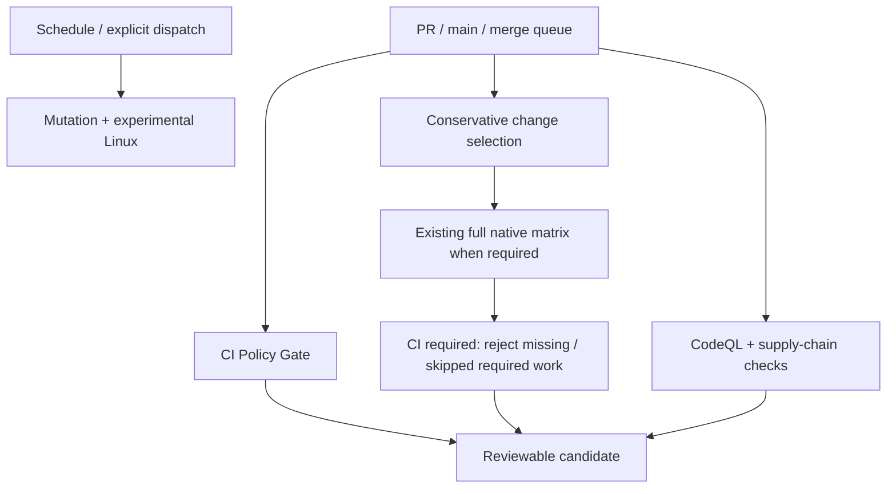
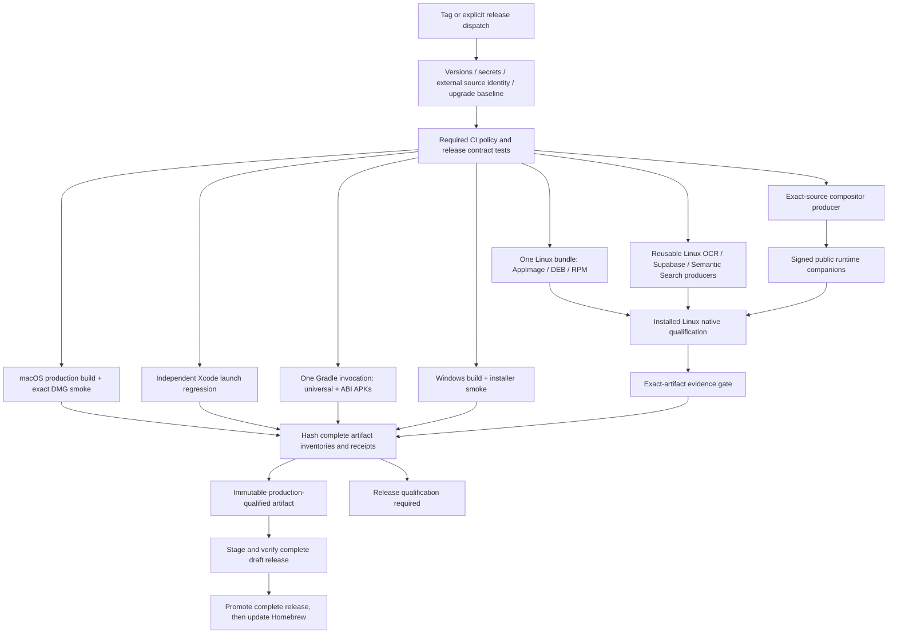

# Delivery architecture

The [complete machine-readable workflow graph](ci-topology.json) includes every
job, dependency, condition, runner, matrix and local reusable-workflow call.
The [initial audit](ci-audit.md) records the earlier graph and timings. No
application business behavior or production Rust optimization was changed.

## Source identity and recovery

Fresh releases need no manual module, compositor or Linux evidence run IDs.
The shared CI policy action is also mandatory before release producers and
qualification, so a direct release dispatch cannot bypass those code-level
engineering gates even when repository branch protection is not configured.
The parent run passes its own identity through reusable workflows. Each
consumer checks repository, source SHA, workflow identity, successful required
producer jobs, complete inventories, expiry, receipt identity and package
digests. An active source is accepted only when it is this exact parent run;
an unrelated active run is rejected. GitHub can mark a parent `queued` while
some reusable jobs are already executing, so producer success is checked
directly instead of assuming that the aggregate run status describes every job.

Existing explicit run IDs remain recovery/diagnostic overrides. External
module/evidence sources are verified in preflight. External evidence must name
its original Linux artifact source. The existing qualification-only mode remains
available and skips all production application builds.

A tag/publication request first discovers retained successful qualification at
that exact source SHA. When found, the existing recovery path authenticates and
promotes its original bytes instead of compiling again. An explicit
`qualified_run_id` can select a specific source. A new tag without prior
qualification builds and qualifies normally; an invalid tag/version fails early.

Release runs serialize by source SHA so a tag cannot race a staging build of
the same commit; the queued tag can then discover and promote that qualification.
The final publisher has a separate global lock for GitHub assets and the shared
Homebrew tap. Standalone module workflows retain their original global module
locks across refs; nested unpublished Linux producers use per-parent-run locks.
None of these producer/publication locks cancels an active run.
They also use GitHub's `queue: max` mode so pending requests are preserved up to
the service's 100-entry queue limit.

The previous Linux upgrade baseline resolves to the newest older published
stable Linux release. The resolver checks the exact tag commit, original Linux
producer jobs and receipts, and matches every package against the public
GitHub asset size and SHA-256. It downloads only Linux packages, avoiding the
other platforms' qualified archive. Missing retained evidence fails before
compilation; an explicit verified previous run remains available for recovery.
First-install qualification is used only when no older stable Linux package exists.

Re-run failed jobs to retain successful producers within the same run. A
publication-only failure or cancellation can also resume through `qualified_run_id`: all
qualification jobs must have succeeded, and failures outside the publisher
remain disqualifying. Publication stages new assets as a draft, verifies every
digest, and only then promotes the release. Existing stable assets are never
overwritten. An interrupted draft upload or unchanged Homebrew update is
idempotent. GitHub publication and the separate Homebrew repository cannot be
one atomic transaction; a failed tap update resumes after the verified release.

Artifact transfers use the shared verified downloader. A failed-job rerun can
retain several artifacts with the same name, and artifact IDs are not a time
ordering. Complete inventories therefore resolve the newest creation time,
reject ties, and never fall back from an expired newest artifact. Downloads use
the resulting immutable IDs and verify the ZIP SHA-256 before safe extraction.
Conflicting merged files, symlinks and escaping paths fail closed. The original
package/receipt/signature checks still run at the consumer boundary.

This behavior was exercised with the isolated
[failed-job retry fixture](https://github.com/dmytro-yevs/copypaste/actions/runs/38804559983).
The first attempt deliberately failed after upload; the second retained the
successful policy job and produced a second same-name artifact. The verified
downloader selected the newer artifact despite its numerically smaller ID.

## Build and cache decisions

Android uses AGP's universal-plus-splits packaging from one Flutter/Gradle
invocation. The universal APK retains ARMv7, ARM64 and x86_64; unsupported x86
libraries from transitive dependencies are excluded through AGP's public JNI
packaging API. The x86_64 split may be emitted by AGP but is not published.
All three published APK names, version codes, certificates, JNI and ABI checks
remain unchanged. Explicit locked `pub get` precedes `--no-pub` builds.

macOS regression runs on a separate VM, with its own build directories and
disposable Keychain. Both regression and exact DMG smoke are required.
Linux still packages one application bundle in three formats and preserves
Fedora RPM installation evidence; GNOME qualification no longer installs KDE.
The module workflows share their existing adapters and a declarative
`config/module-platforms.json` matrix; Linux-only application qualification
cannot publish a partial standalone module release.

Mutter and GNOME Shell fetch the same pinned commits from GNOME's official
read-only GitHub mirrors. Validation encountered a GitLab Gitaly outage returning
HTTP 503; changing the transport preserves the checked commit objects, patches,
licenses and receipts without retries or weaker source verification.

Rust bridge caches share the explicit Rust release profile across Flutter modes,
while daemon/CLI caches isolate their actual debug/release profiles. Both retain
OS/architecture/toolchain boundaries; Flutter mode is not a separate Rust bridge
configuration. Splitting that bridge cache would duplicate identical compilation.
The portable Rust job includes the separate Supabase/SMS workspaces it actually
builds. CodeQL reuses SDK/pub dependencies but still traces fresh Swift/C++
compilation. Compiler caching must never hide those source files from CodeQL.

New receipts include the actual Flutter/Dart/Rust toolchains, runner identity,
build configuration fingerprint, target architectures and profile. Complete
inventories also bind updater signatures, checksums and the macOS CLI archive.
Unexpected files or changed sidecars fail qualification. Historical receipt
schemas remain supported for existing release recovery.

## Deliberately retained boundaries

Production `opt-level=3`, thin LTO and one codegen unit remain unchanged.
The existing evidence profile stays separate. No measured production binary
benchmark justifies changing optimization, linker choice or codegen units.
Configuration Cache remains disabled: adoption needs real Flutter/AGP/custom
task compatibility evidence, including signing tasks; errors are never ignored.
No sccache service, nextest migration, dependency image, DerivedData archive or
paid runner was added without a benchmark demonstrating an end-to-end benefit.

CodeQL manual Swift/C++ builds remain required on PR/main. No-build analysis
has not demonstrated equivalent coverage for this project. The existing
scheduled mutation/experimental checks and all stable Linux runtime companions,
source/signature checks and native scenarios remain intact. GitHub attestations
could supplement the existing signatures/receipts, but replacing those contracts
or adding new identity-token permissions is outside this optimization.

The [engineering standards](ci-standards.md) define local checks, platform
registration, cache trust boundaries and measurement rules.

## Observability

`CI performance report` runs after the main workflows complete and uploads
machine-readable measurements with a Markdown summary. It checks out trusted
reporting code, uses read-only API access, and never executes source-run code
or downloaded artifacts. Timings include wall clock, initial queue delay,
individual jobs/steps, an expanded reusable-workflow critical path, and available
cache restore counts/bytes/duration. Explicit phase markers measure dependency,
compilation and packaging commands without changing their exit codes.

`config/ci-performance-budgets.json` records investigation thresholds derived
from the successful baseline p95. Missing comparable lifecycle samples remain
unbudgeted. These thresholds request investigation; they do not waive correctness
checks or automatically retry a slow build. Compound steps without phase markers
remain compound measurements. Unavailable logs/cache outcomes remain unknown.

Flutter formatting and static analysis run once in `Flutter static checks`.
Native Flutter tests and debug builds still run on each required platform.
The local foundation script retains static checks by default, and `CI required`
also requires the separate static job when CI selects native validation.
