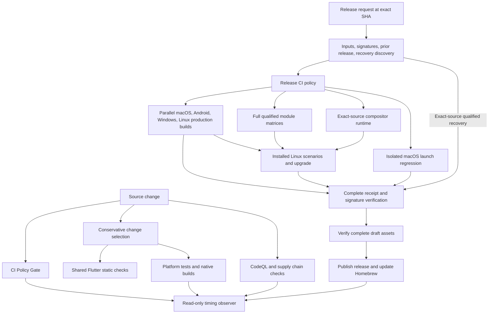

# CI/CD modernization verification report

This report records the CI modernization before integrating the local product
updates into CopyPaste 1.0.27. Final release evidence must bind to that combined
candidate, not to the earlier commits below. See the [baseline](ci-baseline.json),
[observed after measurements](ci-after-summary.json),
[architecture](ci-architecture.md), and [standards](ci-standards.md).

## Delivery architecture

## Observed before and after

Cache cohorts are unknown. The baseline percentiles and individual observations
are descriptive, with different commits and runner queues. **No controlled
percentage speedup or new p95 is claimed.**

| Scope | Before | After | Change and reliability effect |
| --- | --- | --- | --- |
| CI | 7 successes; p50 24m 05s, p95 25m 49s | Run 38802576443: 19m 38s, initial queue 45s | Static checks once; native coverage retained; stable aggregate rejects missing results |
| CodeQL | 9 successes; p50 40m 20s, p95 47m 58s | Run 38802576386: 33m 20s, initial queue 2m 12s | SDK/dependency reuse; traced Swift/C++ compilation retained |
| Release through qualification | Observed same-source chain: 63m 14s across 7 runs, including failed orchestration, repeated builds, and operator gaps | Run 38811404575: 20m 38s, initial queue 4s, one automatic unpublished pipeline | Removes manual evidence IDs and redundant application rebuilds; all required platform gates passed |
| Release through publication | Historical chain: 68m 37s across 8 runs | Not measured in the unpublished modernization tests | Production publication is tested by the authorized 1.0.27 release, not by a disposable production release |
| GNOME qualification | Prior job 326s; dependency install 158s | First new job 205s; dependency install 53s | Removed 5 KDE/Plasma dependencies from the GNOME-only stable environment; installed-product scenarios retained |

The release chain observation compares delivery procedures, not compiler
performance. The historical graph and exact source run IDs are retained in the
machine-readable summary. A later automatic run at 93198da took 25m 22s including
5m 59s initial queue, demonstrating why runner delay must remain visible.
These early qualification measurements built Linux module inputs only. The final
release pipeline also qualifies every publishable module target in the same
parent run, so publication reuses the exact packages tested by the application.
Do not present the early timings as measurements of that larger final matrix.

## Removed duplication

- Android universal, ARM64, and ARMv7 APKs now come from one Flutter/Gradle
  invocation. All output ABI sets, signatures, and shared version codes passed
  real release checks. Isolated compilation time saved has not been measured.
- Flutter format/analyze runs once in CI. Every platform retains native tests
  and builds. Explicit locked dependency resolution remains; build commands use
  `--no-pub` afterward.
- macOS launch regression and production packaging run on isolated runners and
  Keychains. One observed regression job took 478s and can overlap the production
  job instead of extending its serial path.
- Linux upgrade resolution fetches the authenticated Linux artifacts, around
  80 MB in the inspected baseline, instead of the roughly 328 MB complete
  qualified archive. Public release digests are still verified.
- The pinned Flutter Rust Bridge hook uses release Rust compilation even for
  Flutter debug builds. Its compatible bridge cache is shared; application and
  evidence profiles remain distinct. An initially proposed split was withdrawn
  after inspecting the actual hook implementation.
- Release qualification uses the parent run's exact outputs and passes those
  qualified bytes to publication. Independent signature and provenance checks
  remain at each trust boundary.

## Enforced standards

The always-present policy gate combines pinned actionlint, ShellCheck, zizmor,
parsed YAML validation, and positive/negative contract fixtures. It checks
least privilege, immutable action pins, bounded jobs, dependency cycles,
stable required statuses, release guards, producer locks, and verified artifact
transfer. Release preflight invokes the same policy before expensive producers.
AGENTS.md points future contributors to these checks.

GitHub's supported `queue: max` is not yet recognized by actionlint 1.7.12.
The documented adapter validates its structure and suppresses only the obsolete
schema diagnostic; real expression and ShellCheck failure fixtures run every
time. No other lint errors are suppressed. High-severity, high-confidence
zizmor findings block CI; this is not a claim of zero informational findings.

## Failure recovery and publication

- Missing or wrong external inputs fail preflight. Fresh builds produce their
  evidence automatically in dependency order.
- Every artifact download selects an immutable API ID and verifies its archive
  digest before safe extraction. Receipts bind the full inventory, source SHA,
  target, toolchain/configuration, and signing metadata.
- A real failed-job rerun (38804559983, attempt 2) demonstrated duplicate
  artifact names and a newer artifact with a numerically smaller ID. Recovery
  selects the unique latest creation timestamp and rejects ambiguous or expired
  candidates. Successful jobs carried forward without another compilation.
- Exact-source qualified artifacts can recover a failed publisher. Native and
  qualification failures still reject recovery. Existing assets must match;
  missing draft assets can be uploaded before complete verification and promotion.
- Draft verification reads the release by its immutable API ID. GitHub's tag
  endpoint exposes published releases only; an actual private OCR draft returned
  HTTP 404 through that endpoint during release preparation. A regression fixture
  reproduces this API behavior and prevents promotion before ID-based verification.
- Release work serializes by source SHA; pending runs queue instead of replacing
  one another. Explicit cancellation stops new qualification/publication work;
  cleanup and diagnostic aggregates still run.
- The GNOME upstream GitLab outage was resolved using its official read-only
  GitHub mirrors at the same pinned commits. Patch and source identity checks
  remain mandatory; no timeout increase or retry hid the failure.

## Platform extension

Register module targets in `config/module-platforms.json`. Application platform
adapters retain native build, packaging, signing, and installed-product checks.
Extend the existing Linux release/runtime contracts and gate registry together
with policy fixtures before admitting another architecture or desktop. The
stable Linux matrix remains GNOME 46 X11 x86_64; experimental matrices remain
available without implying stable parity.

## Remaining bottlenecks

Android compilation (1,025s in run 38811404575) and macOS compilation (946s)
dominate the latest qualification path. Windows compilation measured 790s.
CodeQL still traces native Swift and C++ builds because no coverage-equivalent
no-build substitution was established. Production Rust optimization is unchanged.
Configuration Cache, sccache, prebuilt dependency images, alternate linkers,
and profile changes were not adopted without compatible measured benchmarks.
Incomplete cache log markers produce unknown rates and transfer measurements,
not invented hit percentages. The observer records future comparable cohorts.

## Runner assessment

Keep standard hosted runners for this public repository. Larger runners have
no measured end-to-end advantage here yet. Illustrative 20-minute compute costs
at the inspected official rates are $0.44 for Linux 8-core, $0.84 for Windows
8-core, and $2.04 for macOS M2 Pro 5-core; queue time and setup can erase a
compiler-only gain. Self-hosted runners add isolation and maintenance costs.
No billing or paid resource changed. See [runner assessment](runner-assessment.md)
for sources and the measurement requirements before adoption.

## Verification record and limits

- Local policy/orchestration tests: 35 passed. Release safety, Linux bootstrap,
  and compositor contract tests: 67 passed. Release helper tests: 197 discovered,
  196 passed and one existing PyGObject/private-D-Bus test skipped locally.
- Real full unpublished qualification succeeded at a27139f0, 93198da2, and
  0c3a4353. The final run above includes the mandatory release policy and the
  verified artifact downloader. All four platform artifact sets, Linux module
  lifecycle and upgrade scenarios, receipts, and the required aggregate passed.
- CI 38812335613 and CodeQL 38812335559 passed at bf7a822e. That source adds
  cancellation-safe work guards after the 0c3a4353 qualification run.
- A complete qualified archive from run 38798650406 was downloaded through the
  new verifier and rechecked against all four platform receipts locally.
- Repeated/partial publication and corrupt/expired/wrong-source artifact cases
  are tested with fixtures. No production publication was used as a test.
- The timing observer activates after merging onto the default branch. Its
  collector has already processed real run logs locally; a branch-only dispatch
  cannot prove automatic workflow triggering.
- These records do not substitute for testing the combined product release
  candidate. Emulator/JVM tests are not physical Android evidence, and portable
  tests are not installed Windows or macOS evidence. Missing native evidence must
  remain explicit in the final release report.
